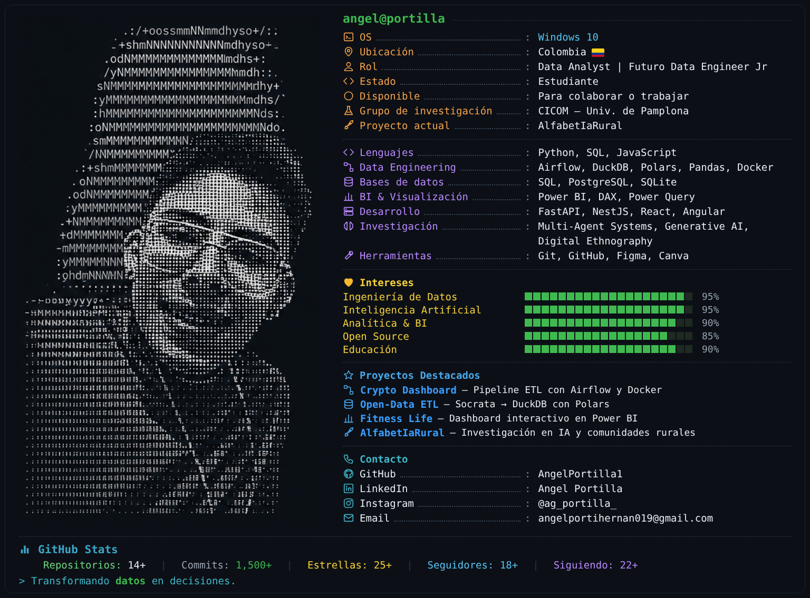

<div align="center">

# 👨‍💻 Angel Portilla

### Data Analyst | Aspirante a Data Engineer Jr | Ingeniero de Sistemas



<br>

[](https://git.io/typing-svg)

</div>

---

## 🚀 Sobre mí

```python
angel = {
    "ubicacion": "Colombia 🇨🇴",
    "rol": "Data Analyst | Futuro Data Engineer Jr",
    "foco": ["Pipelines ETL", "SQL", "Power BI", "IA aplicada"],
    "objetivo": "Convertir datos en decisiones y soluciones con impacto",
    "estado": "Siempre aprendiendo",
}
```

- 📊 Ingeniero de Sistemas enfocado en análisis e ingeniería de datos
- ⚙️ Construyo pipelines ETL con Airflow, Polars y DuckDB
- 📈 Diseño dashboards interactivos en Power BI
- 🔬 Investigador en el grupo CICOM, aplicando IA y sistemas multiagente
- 👯 Abierto a colaborar en proyectos de datos y open source

---

## 📊 Proyectos de Datos

<table>
  <tr>
    <td width="33%" valign="top">
      <h3 align="center">
        <a href="https://github.com/AngelPortilla1/Dags---Airflow" target="_blank">
          ⚙️ Crypto Dashboard con Airflow
        </a>
      </h3>
      <div align="center">
        <a href="https://github.com/AngelPortilla1/Dags---Airflow" target="_blank">
          
        </a>
        <p align="justify">
        Pipeline orquestado con <strong>Apache Airflow</strong> que consulta las 20 principales criptomonedas desde la API de CoinGecko, las procesa con pandas y genera métricas y un dashboard consolidado. El DAG corre diariamente.
        </p>
        <p>
          
          
          
          
        </p>
      </div>
    </td>
    <td width="33%" valign="top">
      <h3 align="center">
        <a href="https://github.com/AngelPortilla1/OpenEtl-DuckDB" target="_blank">
          🦆 Open-Data ETL: Socrata a DuckDB
        </a>
      </h3>
      <div align="center">
        <p align="justify">
        Pipeline ETL end-to-end que extrae datos de la API de Datos Abiertos de Colombia (Socrata) con paginación, los transforma con <strong>Polars</strong> y los carga en <strong>DuckDB</strong> mediante Apache Arrow (zero-copy) para análisis con SQL.
        </p>
        <p>
          
          
          
          
        </p>
      </div>
    </td>
    <td width="33%" valign="top">
      <h3 align="center">
        <a href="https://github.com/AngelPortilla1/powerbi-fitness-life-dashboard" target="_blank">
          🏋️ Dashboard Power BI – Fitness Life
        </a>
      </h3>
      <div align="center">
        <a href="https://github.com/AngelPortilla1/powerbi-fitness-life-dashboard" target="_blank">
          
        </a>
        <p align="justify">
        Dashboard interactivo para una empresa ficticia del sector fitness. Cubre el flujo completo de BI: limpieza con Power Query, modelado de datos, medidas DAX y KPIs, visualización y publicación en Power BI Service.
        </p>
        <p>
          
          
          
        </p>
      </div>
    </td>
  </tr>
</table>

---

## 🔬 Experiencia en Investigación

<table>
  <tr>
    <td width="100%">
      <h3 align="center">
         Proyecto de Investigación: AlfabetIaRural
      </h3>
      <div align="center">

<a href="https://github.com/AngelPortilla1/Arquitectura-Multiagentes-Mediante-Etnografia-digital" target="_blank">
  
</a>

<br><br>

<p>
✅ <strong>Investigador Universitario</strong> — Grupo de Investigación CICOM
</p>

<p align="justify">
Participé como investigador en el grupo de investigación
<strong>CICOM (Grupo de Ciencias Computacionales)</strong>
de la Universidad de Pamplona, contribuyendo al desarrollo del proyecto
<strong>AlfabetIaRural</strong>, una iniciativa orientada a fortalecer
la alfabetización en inteligencia artificial en comunidades del
nororiente colombiano.
</p>

</div>

### 🔹 Principales contribuciones

- Desarrollo de una arquitectura basada en agentes inteligentes para la caracterización de necesidades de alfabetización en IA.
- Aplicación de metodologías de etnografía digital para la recolección y análisis de información comunitaria.
- Integración de modelos de lenguaje (LLMs) y sistemas multiagente para asistentes conversacionales contextualizados.
- Participación en procesos de investigación, documentación científica y validación de resultados.
- Diseño de herramientas tecnológicas para reducir la brecha de acceso y comprensión de la IA en zonas rurales.

<div align="center">

### 🛠 Tecnologías utilizadas


</div>

</td>
</tr>
</table>

---

## 🛠️ Stack Tecnológico

<div align="center">

### 🔄 Ingeniería de Datos


### 🗄️ Bases de Datos & Análisis


### ⚙️ Desarrollo & IA


### 🧰 Herramientas


</div>

---

## 📜 Cursos y Certificaciones

<div align="left">

| 🎓 Certificación | 🏫 Institución |
|---|---|
| Comprender la Ingeniería de Datos | DataCamp |
| SQL Intermedio | DataCamp |
| SQL Fundamentals | DataCamp |
| Data Analysis with Python | DataCamp |
| Manejo de Datos con Pandas | DataBoosters Academy |
| Data AI Literacy | DataBoosters Academy |
| Analítica de Datos con Herramientas Computacionales | Universidad de Pamplona |
| AI Capabilities and Limitations | Anthropic |
| Python para no Matemáticos | Udemy / Codigo369 – AcademiaApps |
| Python Desde Cero | Píldoras de Programación |
| Git y GitHub Desde Cero | Píldoras de Programación |

</div>

---

## 📊 Estadísticas de GitHub

<div align="center">


[](https://github.com/AngelPortilla1)

</div>

---

## 📫 ¿Hablamos?

<div align="center">

¿Tienes un proyecto de datos en mente o quieres colaborar? **¡No dudes en contactarme!**

[](mailto:angelportihernan019@gmail.com)
[](https://www.linkedin.com/in/angel-portilla-18921215b/)
[](https://www.instagram.com/ag_portilla_/)

<br>


**💼 Open to work &nbsp;|&nbsp; 📊 Data Analyst / Data Engineer Jr &nbsp;|&nbsp; 🚀 Siempre aprendiendo**

</div>
